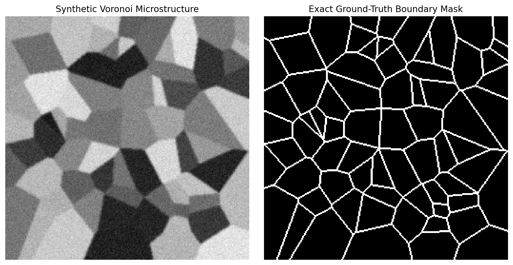
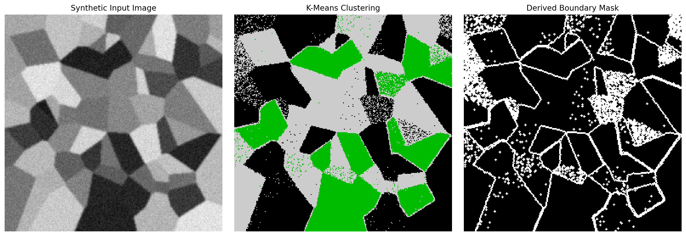
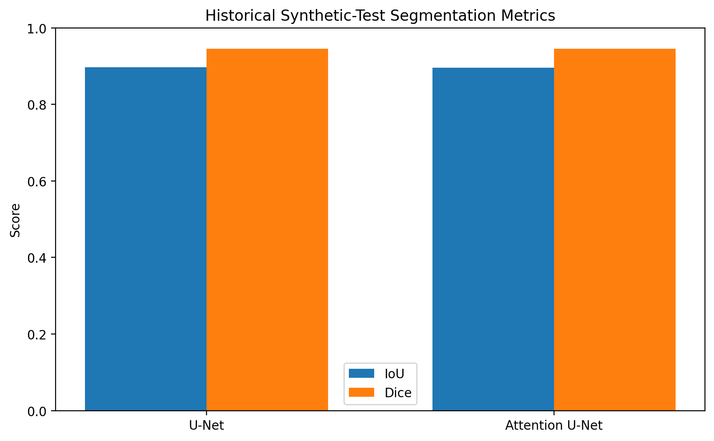
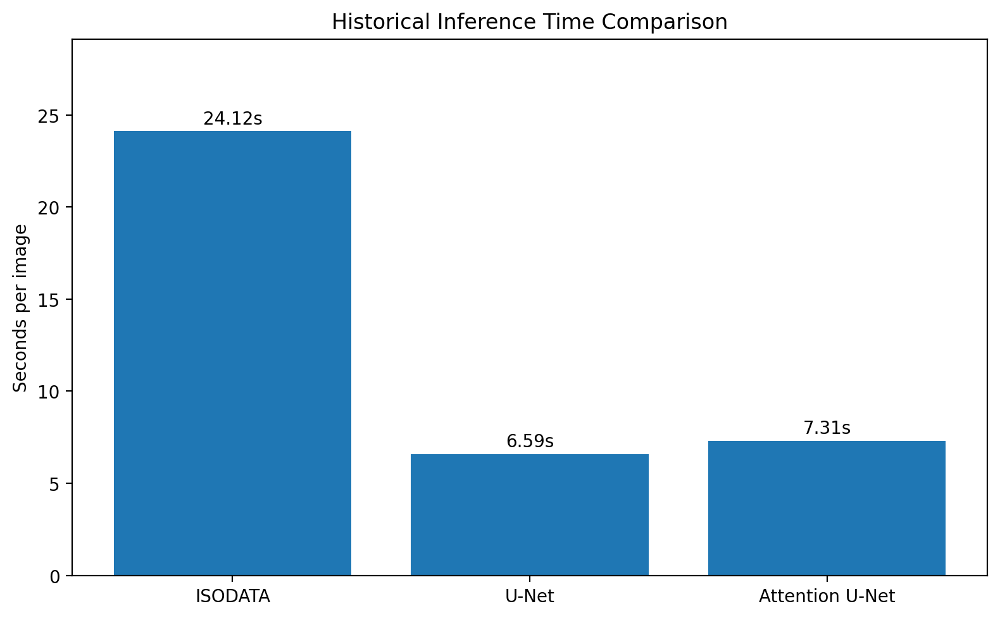

# SEM Image Segmentation Using Synthetic Data and Deep Learning

A computer vision project developed during a 23-week Master's
Personal Programming Project at TU Bergakademie Freiberg (2025).

The project investigates automated grain-boundary segmentation
in Scanning Electron Microscopy (SEM) images using classical
image processing, GAN-based synthetic data generation, U-Net,
and Attention U-Net.

## Public Visual Demonstrations

To preserve data privacy, the original SEM images used in the academic project are not included in this public repository. Instead, the repository provides safe public demonstration figures and historical project metrics.

### Synthetic Microstructure Generation

This figure shows an independently generated Voronoi-based synthetic microstructure and its exact ground-truth boundary mask.

### Classical Segmentation Example

This example shows a public synthetic image together with a classical K-Means segmentation result and the derived boundary mask.

### Historical Synthetic-Test Accuracy

These values are historical results from the original academic project and correspond to synthetic test data.

### Historical Inference-Time Comparison

These values are historical timing results reported in the original academic project.

## Additional Project Notes

A brief public summary of the project is available in [docs/PROJECT_OVERVIEW.md](docs/PROJECT_OVERVIEW.md).

**Full academic report:** available upon request.  
The original report contains private SEM imagery provided for academic use only and is therefore not redistributed publicly in this repository.

## Project Overview

The workflow consists of:

1. Classical segmentation using K-Means, ISODATA, and SLIC.
2. Synthetic microstructure generation using Voronoi tessellation.
3. GAN-based refinement of synthetic images.
4. Training U-Net and Attention U-Net for grain-boundary segmentation.
5. Tiled inference on high-resolution SEM images.
6. Grain statistics and segmentation evaluation.

## Technologies

Python, PyTorch, OpenCV, NumPy, SciPy, scikit-image,
scikit-learn, Pandas, and Matplotlib.

## Original Experimental Results

The original academic experiments reported:

| Model | Synthetic Test IoU | Synthetic Test Dice |
|---|---:|---:|
| U-Net | 0.8965 | 0.9454 |
| Attention U-Net | 0.8957 | 0.9450 |

Reported processing times for a 1387 x 2048 SEM image:

| Method | Time |
|---|---:|
| ISODATA | 24.12 s |
| U-Net | 6.59 s |
| Attention U-Net | 7.31 s |

These are historical results from the original academic project.
They have not been independently reproduced for this public release.

## Data Availability

The original SEM images and datasets are not publicly distributed
because of data-access restrictions.

Trained model checkpoints are also excluded from this repository.

The source code is provided to document the implementation.
Running the complete original workflow requires suitable input
data and model checkpoints or independently trained replacements.

## Evaluation Limitations

- Reported IoU and Dice scores originate from synthetic test data.
- Real SEM evaluation includes qualitative segmentation and grain
  statistics, not verified pixel-level accuracy against manually
  annotated real-image masks.
- The original U-Net and Attention U-Net experiments did not use
  a documented common, fixed random split.
- The original training code evaluated the final model state,
  rather than reloading the best-validation checkpoint.
- The original report's median-diameter column contains values
  corresponding to standard deviations.
- A grain-count calculation in the training code was corrected
  in this public copy; historical results were not recomputed.

## Repository Status

This repository preserves the implementation of the original
2025 academic project with minimal maintenance corrections.
No models were retrained for this public release.

## License

The source code is released under the [MIT License](LICENSE).

The original SEM datasets and third-party microscopy images
are not included in this repository and are not covered by
this license.

The original academic report is retained privately because
it contains SEM imagery provided for academic use only.